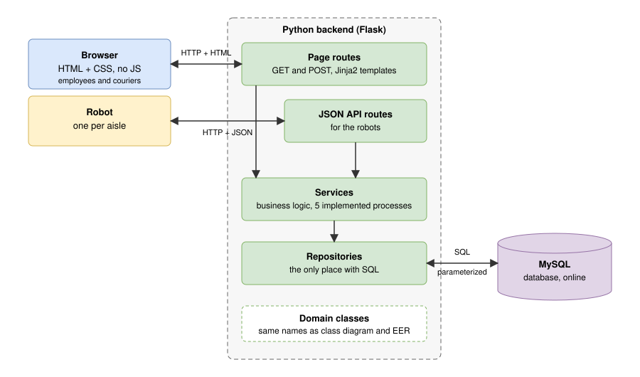

# Software architecture

Issue: Define software architecture. This document describes how the frontend, backend and database fit together, why we chose this setup, and how we build and host it.



Source: [architecture.drawio](architecture.drawio). Update the `.drawio` file and the `.svg` export together.

## Contents

1. [Context and goals](#context-and-goals)
2. [Overview](#overview)
3. [Key decisions](#key-decisions)
4. [Frontend](#frontend)
5. [Backend](#backend)
6. [Request flow](#request-flow)
7. [Robot communication](#robot-communication)
8. [Database](#database)
9. [Users and screens](#users-and-screens)
10. [Project structure](#project-structure)
11. [Configuration and security](#configuration-and-security)
12. [Error handling](#error-handling)
13. [Testing](#testing)
14. [Hosting and deployment](#hosting-and-deployment)
15. [Traceability](#traceability)
16. [Risks](#risks)
17. [Open points](#open-points)

## Context and goals

Timaflu is a wholesaler of medicines that supplies pharmacies. Sales stays by telephone, so the system is used by employees, not by customers. The system must replace the Excel forms, mails and paper picking and distribution slips with one place where addresses, orders, customers and manufacturers are managed.

What the architecture must support:

- The six processes in scope: sales, purchasing, order picking, distribution, administration and invoicing, and acquisition.
- Reliable stock information: when a customer orders a medicine, the system must say with certainty whether it is in stock.
- A visible order status (for example collecting, sent, backorder, delivered), so the customer knows exactly where the order stands.
- Robots that collect orders automatically, one robot per warehouse aisle, so several robots can work on one order.
- Monitoring of the minimum stock per medicine, so purchasing sees which products to reorder from the cheapest supplier.

Constraints from the product description:

- Frontend: HTML and CSS only, no libraries, no JavaScript.
- Backend: Python, with all classes and methods present. Five processes are fully implemented, the rest may be empty.
- Database: MySQL, normalized, online and filled with relevant data.
- Hosting must be free.
- Out of scope: receiving new stock.

## Overview

The system has three parts: a frontend of plain HTML and CSS, a Python backend that serves it, and a MySQL database. The robots in the warehouse use the same backend through a small JSON API.

| Part | Technology | Talks to |
| --- | --- | --- |
| Frontend | HTML, CSS (no libraries, no JS) | Backend, over HTTP |
| Backend | Python, Flask, Jinja2 | Browser, robots and database |
| Database | MySQL | Backend only |
| Robots | Any HTTP client | Backend JSON API |

## Key decisions

| Decision | Choice | Why | Alternative considered |
| --- | --- | --- | --- |
| How the frontend gets data | Server-side rendering: the backend fills HTML templates | Without JS a page cannot fetch data itself | A separate JS frontend calling a JSON API: not allowed by the constraints |
| Web framework | Flask with Jinja2 | Small, well documented, one dependency for routing and templates | Django: too much for this scope. Standard library `http.server`: too much manual work |
| Changing data | HTML forms with POST, then redirect to a GET page | Works without JS and prevents double submits on refresh | Links with GET for changes: unsafe and wrong |
| Structure | Layers: routes, services, repositories, domain classes | Maps directly to the class diagram and keeps SQL in one place | Everything in the routes: hard to test and to trace |
| Database access | Plain SQL in repositories, parameterized | The query document with SQL per screen is a deliverable, so the SQL must be visible | An ORM: hides the SQL we have to deliver |
| Robots | Separate JSON API on the same backend | Robots are not browsers and need machine-readable answers | Giving robots the HTML pages: fragile to parse |
| Deployment | One backend application and one database | Simple to host for free and to explain | Separate services: unnecessary for a school project |

## Frontend

- Plain HTML and CSS, no libraries and no JavaScript, as the product description requires.
- Without JS a page cannot fetch data by itself. Every page is rendered on the server: the backend fills an HTML template with data from the database and sends finished HTML to the browser.
- Navigating is done with links (GET). Changing data is done with HTML forms (POST), for example placing an order or marking a delivery as delivered.
- After a successful POST the backend redirects to a GET page (post/redirect/get), so refreshing the page never submits a form twice.
- One template per screen from the screen designs. The order picking and distribution screens are responsive (CSS media queries) and work on mobile devices. The other screens are designed for desktop.
- Behaviour that normally needs JS is solved with HTML and CSS: filtering and searching by a form with a GET parameter, validation by HTML attributes (`required`, `type`, `min`, `pattern`) plus validation on the server, and show or hide with a link to another page.
- Shared layout (header, navigation, footer) lives in one base template that every screen extends, so the look stays the same.
- One stylesheet with shared styles, plus small sections for the responsive screens.

### What are Jinja2 templates

Jinja2 is the template engine that comes with Flask. A Jinja2 template is an HTML file with a few extra placeholders and simple instructions. The backend fills in those placeholders with data from the database and sends the finished HTML to the browser. The browser never sees the template itself, only the result, so it is plain HTML and CSS with no JavaScript.

There are three kinds of markers:

| Marker | Purpose | Example |
| --- | --- | --- |
| `{{ ... }}` | Print a value | `{{ order.status }}` |
| `` | Logic: loops, conditions, extending a layout | `` |
| `{# ... #}` | Comment, not sent to the browser | `{# order table #}` |

Example of a template for a list of orders:

```html



  <h1>Orders of {{ customer.name }}</h1>
  <table>
    
      <tr>
        <td>{{ order.number }}</td>
        <td>{{ order.status }}</td>
      </tr>
    
      <tr><td>No orders yet.</td></tr>
    
  </table>

```

The page route passes the data to the template, for example `render_template("orders.html", customer=customer, orders=orders)`. If the customer has two orders, the browser receives a normal HTML table with two rows.

Why we use them:

- **No JavaScript needed.** The server does the work that JS would otherwise do in the browser: fetching data and putting it on the page.
- **One layout for every screen.** The `base.html` template holds the header, navigation and footer. Every screen template starts with `` and only fills in its own `content` block, so a change to the layout is made in one place.
- **One template per screen.** This maps directly to the screen designs (see [Traceability](#traceability)).
- **Safe output.** Jinja2 escapes values by default, so a customer name containing `<script>` is shown as text and never runs (see [Configuration and security](#configuration-and-security)).

Rules for templates: they only show data and contain no business logic or SQL. Decisions such as "may this order be delivered" are made in the services, and the template only displays the result.

Because a template contains Jinja2 markers, it is not pure HTML. The output that the browser receives is pure HTML and CSS. See the first risk in [Risks](#risks).

## Backend

Python with Flask. Flask (with its template engine Jinja2) is the only web dependency, to keep dependencies minimal. The code is split in layers so every class is easy to find and to trace to the class diagram.

| Layer | Responsibility |
| --- | --- |
| Page routes | Receive a browser request, call a service, return a rendered template or a redirect |
| JSON API routes | Same as page routes, but for the robots: JSON in, JSON out |
| Services | The business logic, including the five fully implemented processes |
| Repositories | The only place with SQL. They return domain classes |
| Domain classes | Customer, Order, Product, Supplier, Invoice and so on. Same names as in the class diagram and the EER |

The five processes that must be fully implemented live in the services layer:

| # | Process | Input | Output |
| --- | --- | --- | --- |
| 1 | Order discount (sales) | Customer name, address and total of the ordered products | Total amount and the discount given. First order of a customer gets 10%, plus the customer discount over the past year |
| 2 | Product out of stock (purchasing) | Product name | Suppliers, cheapest first, with contact person and phone number. Supplier or product can be removed |
| 3 | Unpaid invoice (administration) | Customer number | Invoice in the prescribed layout, including 9% VAT and the discounts |
| 4 | Customer absent at delivery (distribution) | Date | Delivery schedule. A customer who is absent is marked for a return visit the same day and the schedule is adjusted |
| 5 | Potential customer without order (acquisition) | A visit, or the acquisition overview | Visit added, or all companies that have not ordered and were last visited a month or longer ago, with the option to give 10% discount and create a customer account |

Rules for the layers:

- A route never contains business logic or SQL.
- A service never contains SQL and never knows about HTTP.
- A repository never contains business logic.
- Calls only go downwards: routes, services, repositories.
- Domain classes know nothing about the layers above them.
- A service receives its repositories through its constructor, so a test can give it a fake repository.

Documentation inside the code: every class and method has a docstring with its purpose, parameters and return value. Names are English and follow the class diagram.

### What are repositories

A repository is a Python class that holds all database access for one aggregate, for example `OrderRepository` or `CustomerRepository`. It is the only place in the backend with SQL. The queries are the core of a repository, but it is more than a collection of queries: every method also takes parameters, runs the query and converts the result into domain classes.

Example:

```python
class OrderRepository:
    def __init__(self, connection):
        self.connection = connection

    def get_by_id(self, order_id):
        """Return the Order with this id, or None if it does not exist."""
        cursor = self.connection.cursor(dictionary=True)
        cursor.execute("SELECT * FROM orders WHERE id = %s", (order_id,))
        row = cursor.fetchone()
        return Order(**row) if row else None
```

A service calls `order_repository.get_by_id(5)` and gets an `Order` back. It does not know that SQL is behind it, and it never sees a raw database row.

What a repository does:

- **Runs the SQL.** SELECT, INSERT, UPDATE and DELETE for MySQL, always parameterized (`%s` with a tuple of values), never by building the query from strings.
- **Converts rows to domain classes.** Methods return `Order`, `Customer`, `Product` and so on, or lists of them.
- **Hides the database from the rest of the code.** Routes and services only know the repository methods.

What a repository does not do:

- No business logic. "Is this order allowed to be delivered" is decided in the service. The repository only reads and writes.
- No HTTP. It knows nothing about requests, forms or JSON.

Why we use them:

- **SQL in one place.** A change to a table or query is made in one file, and the queries stay visible for the query document.
- **Testable services.** A service receives its repository through the constructor, so a test can pass a fake repository and run without a database.
- **Traceable.** One repository per aggregate maps to the tables in the EER and the classes in the class diagram (see [Traceability](#traceability)).

## Request flow

Example: a courier marks a delivery as delivered.

| Step | Where | What happens |
| --- | --- | --- |
| 1 | Browser | The courier submits the form on the distribution screen (POST) |
| 2 | Page route | Reads the form fields and calls the delivery service |
| 3 | Service | Checks the rules (the order exists and is out for delivery), changes the status to delivered |
| 4 | Repository | Runs the parameterized `UPDATE` and returns the updated order |
| 5 | Database | Stores the new status |
| 6 | Page route | Redirects to the GET page of the delivery schedule |
| 7 | Browser | Requests the schedule, the route renders the template with fresh data |

Example: a robot reports that a collection crate is full.

| Step | Where | What happens |
| --- | --- | --- |
| 1 | Robot | Sends a JSON message with its aisle, the partial order and the crate code |
| 2 | JSON API route | Validates the message and calls the order picking service |
| 3 | Service | Links the crate to the order and updates the picking status |
| 4 | Repository and database | Store the link between crate and order |
| 5 | JSON API route | Answers with JSON: accepted, and whether the robot gets a new crate or a new partial order |

## Robot communication

Robots are not browsers, so they do not use the HTML pages. Each robot (one per aisle) talks to the JSON API routes. The exact endpoints follow from the use case diagram of the robot and the order picking activity diagram. Expected calls:

- Get the next partial order for this aisle
- Report the scanned code of a collection crate
- Report that a crate is full and put on the conveyor belt
- Report that the partial order is complete, so a new one can be assigned

Agreements for the API:

- Requests and answers are JSON, with clear field names that match the domain classes.
- Every answer has an HTTP status code that matches the result: 200 for success, 400 for a wrong request, 404 for an unknown order or crate, 409 for a conflict.
- Calls that change data are POST. The robot sends its aisle number in every call.
- Because several robots work on one order, the service must handle two robots updating the same order at about the same time. The database transaction decides the final state.
- The distribution corner shows which order is in which crate. That screen reads the same data the robots write.

The endpoints that are built, with their requests, responses and errors, are in the [API specification](api-specification.md).

## Database

- MySQL, normalized, hosted online and filled with enough relevant data.
- Only the backend talks to the database, always through parameterized queries from the repositories. The browser and the robots never access it directly.
- The queries per screen in the query document are the same queries the repositories run.
- Table and column names follow the EER and the domain classes.
- Changes that touch several tables (for example saving an order with its order lines and updating stock) run in one transaction, so the data is never half written.
- Stock is only changed through the services, so the answer to "is this medicine in stock" is always the same one.
- The EER in the repository must always match the working database.
- The database is created from SQL scripts kept in the repository (`schema.sql` first, then `seed.sql`), so anyone can rebuild it.

## Users and screens

The system is used by employees. Each role uses its own screens, which come from the screen designs.

| Role | Process | Examples of what they do |
| --- | --- | --- |
| Sales employee | Sales | Look up a customer, place an order, see the order status |
| Purchasing employee | Purchasing | See products below minimum stock, reorder from the cheapest supplier |
| Warehouse and distribution corner | Order picking, distribution | See which order is in which crate, pack the order |
| Courier | Distribution | See the delivery schedule and urgent rides, look up a phone number, mark a delivery as delivered or customer absent |
| Administration employee | Administration and invoicing | See delivered orders to invoice, see unpaid invoices, produce an invoice |
| Acquisition employee | Acquisition | Register a visit, see the acquisition overview |
| Robot | Order picking | Uses the JSON API, no screens |

The courier and distribution screens are responsive, because they are used on mobile devices.

## Project structure

Layout of the code in the `code/` folder. It can change once the class diagram is final. See [code/README.md](../../code/README.md) for how to run it locally.

```text
code/
  backend/
    app.py               creates the Flask app, registers the routes and error handlers
    config.py            reads settings from environment variables
    db.py                opens one database connection per request
    routes/              page routes and JSON API routes, one file per process
    services/            business logic, one file per process
    repositories/        SQL, one file per aggregate (customer, order, product, ...)
    domain/              domain classes and domain errors
    requirements.txt     Python dependencies
    .env.example         names of the environment variables
  frontend/
    templates/           Jinja2 templates, one per screen, plus a base template
    static/css/          stylesheets
  database/
    schema.sql           creates the tables
    seed.sql             fills the tables with relevant data (to be written)
    queries.sql          the queries per screen (to be written)
```

The frontend folder only contains HTML templates and CSS, so it can be handed in as the frontend zip. The backend folder is handed in as the backend zip.

## Configuration and security

- Settings (database host, name, user, password) are read from environment variables. Passwords are never committed to the repository. A `.env.example` file lists the variable names without values.
- The backend uses its own database user with only the rights it needs, not the administrator account.
- All SQL is parameterized, so user input can never change the query.
- Jinja2 escapes output by default, which protects against injected HTML. Do not turn this off.
- All input is validated on the server. HTML attributes are only a convenience.
- The connection to the database uses an encrypted connection if the host supports it.
- Medicine and customer data is sample data. No real personal data is stored.
- Whether employees must log in is not decided yet (see open points).

## Error handling

- A service raises a clear domain error for a broken rule (for example product not found, order already delivered). The route turns that into a friendly message on the page, or into a 4xx answer for the robots.
- Unexpected errors are logged on the server and the user sees a general error page without technical details.
- If the database cannot be reached, the user sees an error page and the problem is logged.

## Testing

- Repositories are tested against a test database or by hand with the queries from the query document.
- Each screen is checked by hand on desktop size. The order picking and distribution screens are also checked on a phone.
- The output of the queries in the query document comes from the real database, not from made up data.

## Hosting and deployment

Hosting must be free. The group has a school email.

- Candidate: Azure for Students (App Service for the backend, Azure Database for MySQL for the database), claimed with the school email. Check the credit and eligibility on the Azure and GitHub Education pages before deciding.
- The MySQL database costs credit, so keep an eye on the usage and stop it when it is not needed.
- One group member creates the account and shares access, so the credit is not spread over several accounts.
- During development everyone can run the backend locally against a local MySQL, using the SQL scripts from the repository.
- Deployment is done from the main branch after a reviewed pull request, as agreed in the working agreements.

## Traceability

| Product | How it connects |
| --- | --- |
| Activity diagrams | Each step that the system supports becomes a service method |
| Use cases | Each primary use case becomes a route and a service method |
| Screen designs | One template and one page route per screen |
| Class diagram | Domain classes, services and repositories |
| Sequence diagrams | Route, service, repository, database for the five processes |
| EER | Tables map to domain classes and repositories |
| Query document | The queries per screen are the queries in the repositories |

## Risks

| Risk | Effect | What we do |
| --- | --- | --- |
| Jinja2 templates are not pure HTML, while the assignment asks for a website of HTML and CSS | The frontend zip may not be accepted as plain HTML | Ask the teacher early. Fallback: also hand in the rendered pages as static HTML |
| Azure credit runs out | The database goes offline | Watch the credit, stop the database when not in use, keep an SQL export |
| Student verification fails | No free credit | Use the GitHub Student Developer Pack route, or look at other free hosts |
| Two robots update one order at the same time | Wrong order status | Use database transactions and test this case |
| Architecture and class diagram drift apart | Hard to trace | Update this document when the class diagram changes |

## Open points

- Hosting must be free. Candidate: Azure for Students, see the hosting section. Decide after checking the official pages.
- Fix the robot endpoints once the robot use case diagram is final.
- Decide whether employees need a login, and if so which roles see which screens.
- Ask the teacher whether server-rendered templates are acceptable for the frontend deliverable.
- Check the final folder layout against the class diagram.
